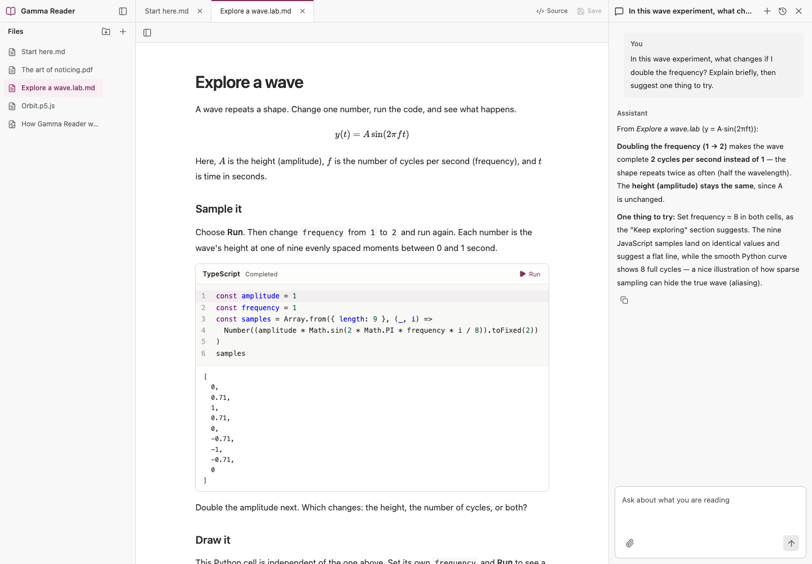

# Gamma Reader

A browser-native, local-first workspace for reading, experimenting, and creating with AI, powered by [pi](https://github.com/earendil-works/pi).

[Try Gamma Reader](https://reader.upivot.io). Import documents into your browser; no account is needed for browser-only projects.

[](https://reader.upivot.io)

## Features

The app opens on a Tutorial project that shows every feature in use; its chapters are also readable in [`tutorial/`](tutorial/Start%20here.md).

- **Read** PDF, Word, Excel, CSV, Markdown, HTML, images and source code in tabs, each with the controls its format allows.
- **Write** Markdown with formulas, diagrams and images, and save it in the browser.
- **Link notes** by name with `[[…]]`, see what links back, and embed one note, section or passage in another.
- **Run code** in Labs, Markdown with Scheme, Clojure, Python and TypeScript cells, and embed p5 sketches and HTML pages at any size.
- **Ask the assistant** about what you read: it searches and reads your files, compares sources, runs Lab cells, searches the web when allowed, and writes notes. Its agent loop runs in the browser.
- **Organise** files in projects, bring in folders and links, and keep a project in step with a source.

## Three ways to use it

| Mode | Start here | Save back |
| --- | --- | --- |
| **Browser only** | Open [the online reader](https://reader.upivot.io) and add files, a folder or a URL | Export files to your computer |
| **Remote git repository** | [Configure a server](docs/sync-from-repository.md#remote-repository) to keep pulling a clone | Read-only by default; `GAMMA_SOURCE_PUSH=1` enables commit and push |
| **Local git working tree** | Run `npx gamma-reader` in your checkout | **Save** above Files writes to disk; you commit and push with git |

All three keep a copy of the imported or synced documents in this browser's IndexedDB. Adding a folder is a one-time import with [filters](tutorial/guide/Files%20and%20projects.md#what-a-folder-leaves-out); connecting a source keeps the copy in sync.

The online reader needs nothing installed. For a local working tree, install **Node 24 and git**, then run:

```sh
npx gamma-reader                                  # the current folder, at http://127.0.0.1:3302
npx gamma-reader ~/notes --exclude tmp,output     # or name one; --help lists the options
```

The project is named after the folder, which must belong to a git working tree. Chat uses `GLM_API_KEY` or `DEEPSEEK_API_KEY` from the process environment, or a model added in the reader. npx does not load `.env` automatically; see [Configuration](docs/self-hosting.md#configuration) for loading it and setting chat allowances.

## Local-first by design

Previewing, parsing, searching and the pi agent loop run in the browser. A connected source can also hold your documents on disk or in a repository. AI inference runs at the model provider: on the shared allowance through a Node proxy that holds the credentials but stores no conversation content, and with a reader's own key straight from the browser. Web search queries go through the server to Tavily. See [Your data and models](tutorial/guide/Your%20data%20and%20models.md) for what leaves the browser.


## Development

Use Node 24 and pnpm 10.14.0.

```sh
corepack enable
pnpm install
pnpm dev
```

Open [http://localhost:5302](http://localhost:5302). Reading, editing, and experiments work without keys; chat needs `GLM_API_KEY`, `DEEPSEEK_API_KEY`, or both in an untracked root `.env`, or a reader's own model. To read a working tree with the code as it is, name it when starting:

```sh
GAMMA_SOURCE_NAME=notes GAMMA_SOURCE_WORKTREE=$HOME/notes pnpm dev
```

`pnpm check` runs Biome, TypeScript, and package tests without rewriting source. Tests do not call external model services. [`AGENTS.md`](AGENTS.md) describes the packages and how the web source is layered, and [Self-hosting](docs/self-hosting.md) lists every variable and covers deploying with Docker and releasing a version.

The independent React Code Lab package lives in `ui-packages/code-lab`. Run its standalone examples with `pnpm --filter @gamma-reader/code-lab-playground dev`.

[`tutorial/`](tutorial/) ships with each deployment and is served at `/api/tutorial`, listed afresh on each request. Every reader has a Tutorial project kept in step with it: a first visit opens it, and after a deployment that changes the folder, the project offers **Update**. To write for it, edit the folder and run `pnpm dev`; the open Tutorial offers the change at once. Add a section to [`What's new.md`](tutorial/What's%20new.md) when a release adds a feature.

## License

[MIT](LICENSE)
